<p align="center">
  
</p>

<h1 align="center">Kairo</h1>

<p align="center"><b>A self-hosted personal and family assistant you talk to.</b><br>
Notes, tasks, reminders, calendar, lists and memory, by voice or text, on your own server.</p>

<p align="center"><b>English</b> · <a href="README.es.md">Español</a></p>

<p align="center">
  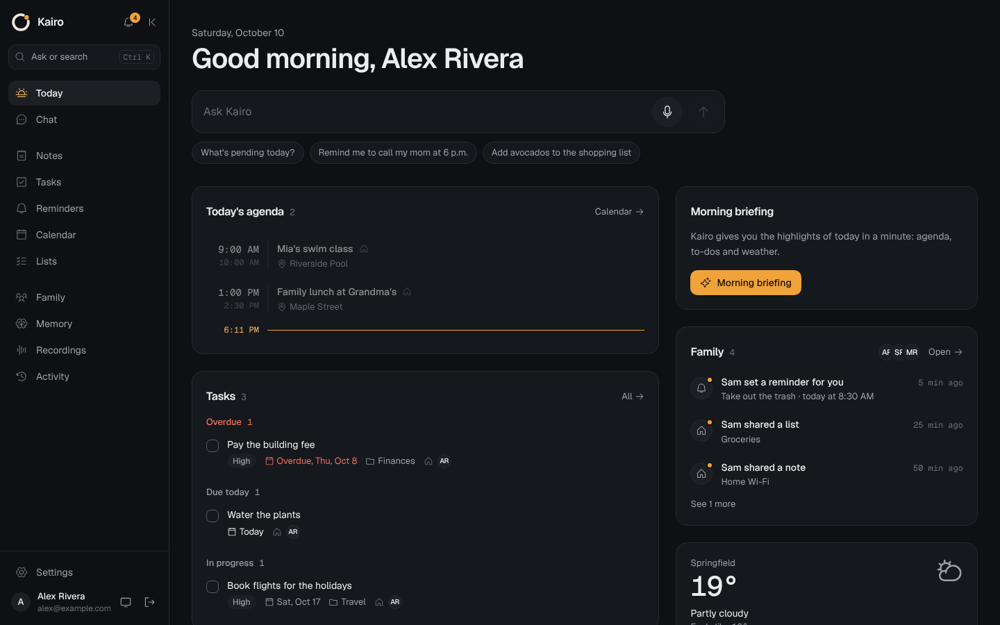
</p>

*Kairós* is the opportune moment: Kairo tells you right when you need it. The icon is an open ring (the cycle of time)
with an amber dot (the precise instant), which doubles as the animated voice orb inside the apps.

## Why Kairo

Most assistants are a chat box that forgets you and lives in someone else's cloud. Kairo is different:

- **You own it.** One Docker Compose stack on your server: Kotlin backend, PostgreSQL, a web dashboard. Your notes,
  tasks and memory live in your database. Only the text and audio needed to answer go to the AI provider.
- **It acts, it doesn't just talk.** Say "remind me to call mom at 6" or "add milk to the shopping list" and it
  creates the reminder or list item, shows you what it did, and lets you **undo** it.
- **Made for families.** Everyone gets their own account on the same server. Personal things stay private (even from
  the admin); family things (shared lists, events, tasks, notices) are visible to everyone at home.
- **Native apps everywhere.** Android and Wear OS, iPhone, iPad and Apple Watch, and a web dashboard. Reminders ring
  exactly on time, offline, from the device itself.
- **No Firebase, no Google services required.** Push goes through your own server (UnifiedPush/ntfy, Web Push, APNs).
- **English and Spanish** out of the box, following your device language. Adding a language is a single file.
- **Open source** under the Apache License 2.0.

## What it does

Talk to it ("Hey Kairo...") or type, and it acts:

| Area | Examples |
|---|---|
| **Notes** | "Note that the wifi password at the office is..." · semantic search ("what did I write about the insurance?") · notes from photos |
| **Reminders** | at a time, recurring ("every Monday at 8"), by place ("when I get home"), snooze |
| **Tasks** | projects, priorities, due dates, Kanban board, subtasks by voice |
| **Calendar** | create, move and query events; alerts; two-way sync with Google Calendar |
| **Lists** | shopping lists and checklists by voice ("add milk and eggs to the shopping list") |
| **Memory** | remembers your preferences and facts ("my daughter is called...") and uses them in answers |
| **Morning briefing** | every morning: agenda, tasks, reminders and weather, read aloud |
| **Recordings** | record meetings or long voice notes: transcript, summary, key points and tasks |
| **Timers and alarms** | "set a 10 minute timer" (on the phone) |
| **Save to Kairo** | share text, links or photos from any app (an invoice becomes a note plus a reminder) |
| **External tools (MCP)** | connect MCP servers and Kairo uses their tools |
| **Undo** | everything Kairo does is logged in *Activity* and can be undone |
| **Family** | "schedule a shared appointment", "our shopping list", "remind Sam to...", "tell everyone dinner is ready" |

Personal items are private and family items are shared with everyone at home. See [`docs/FAMILY.md`](docs/FAMILY.md).

## Screenshots

| Dashboard | Phone | Foldable (open) |
|---|---|---|
|  | 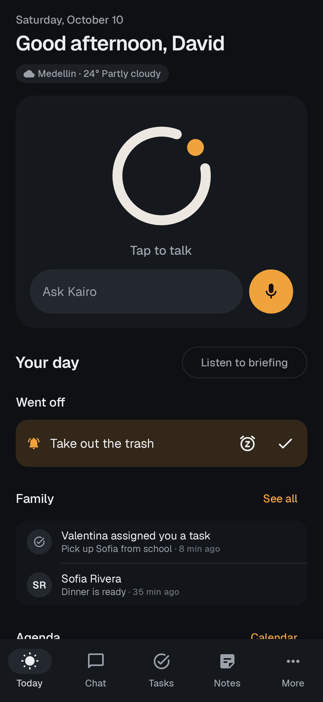 | 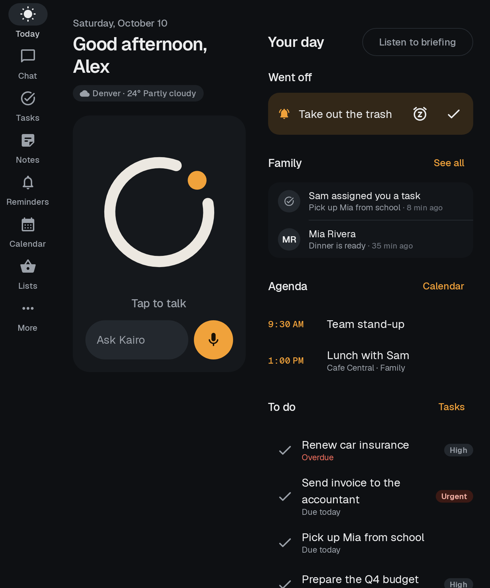 |
|  | 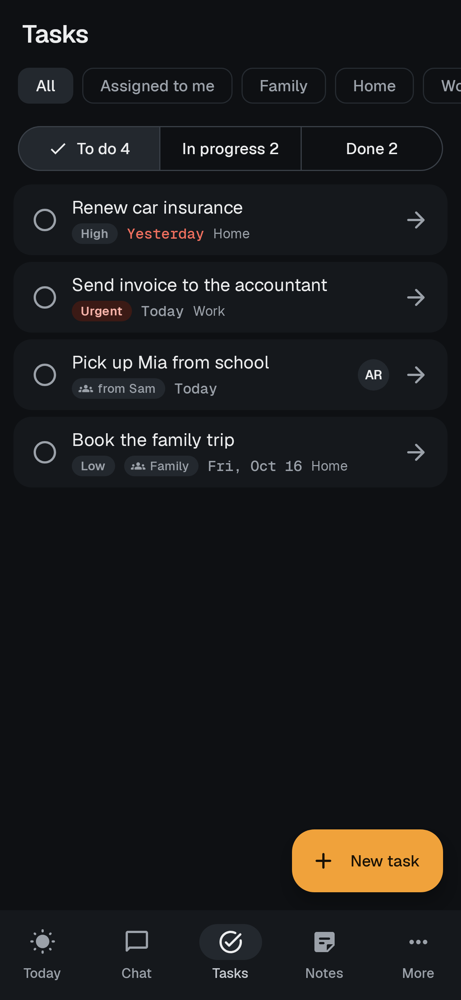 | 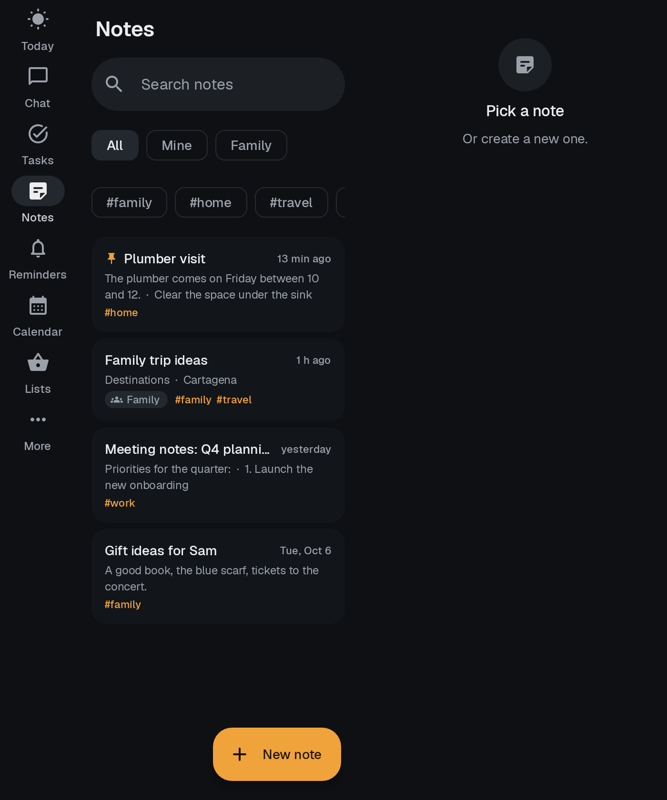 |
| 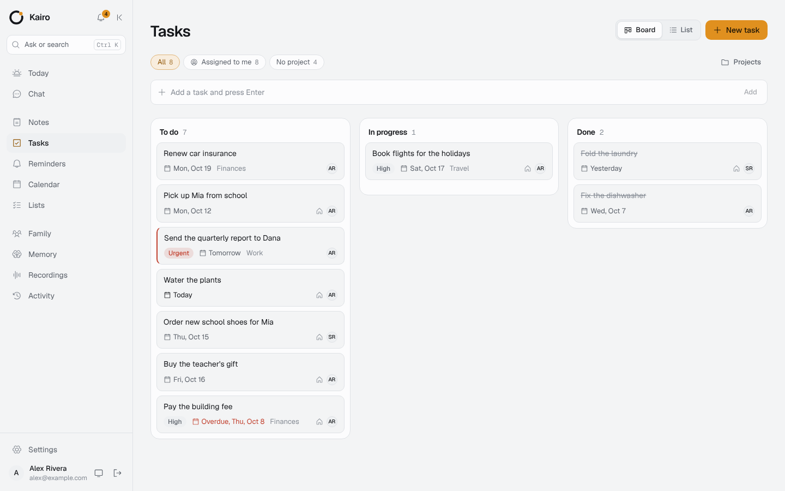 | 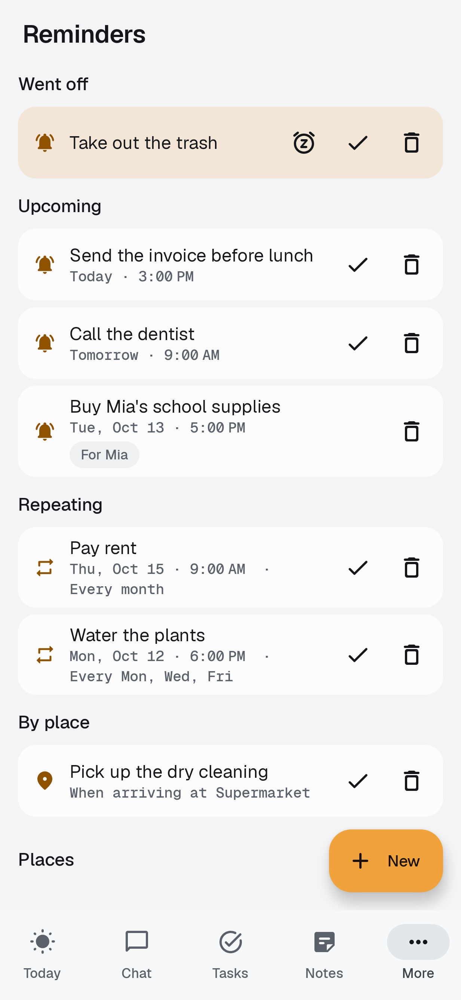 | 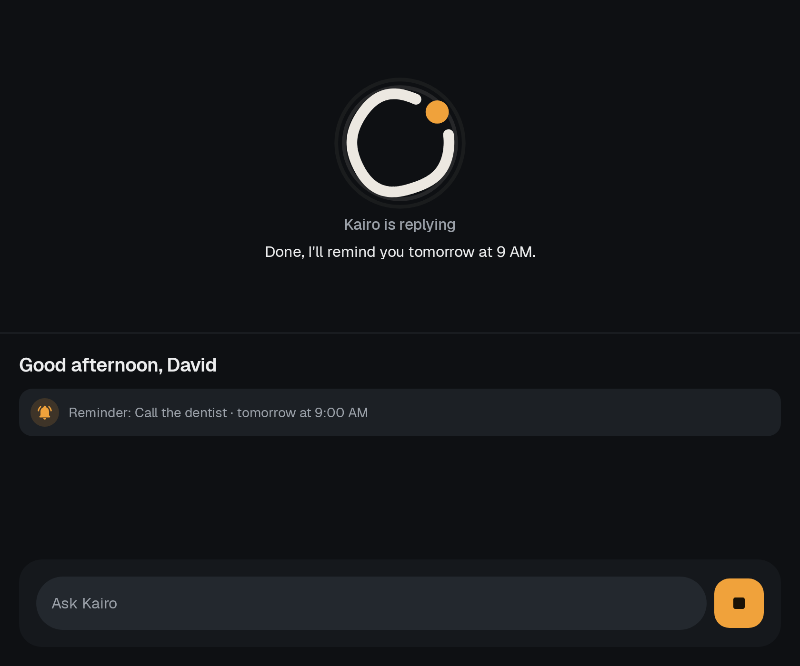 |

| iPhone | iPhone (dark) | Tasks | Family |
|---|---|---|---|
| 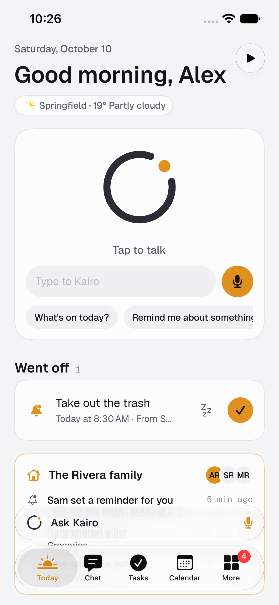 | 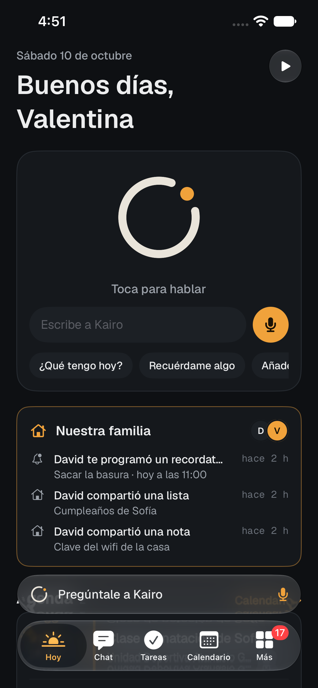 | 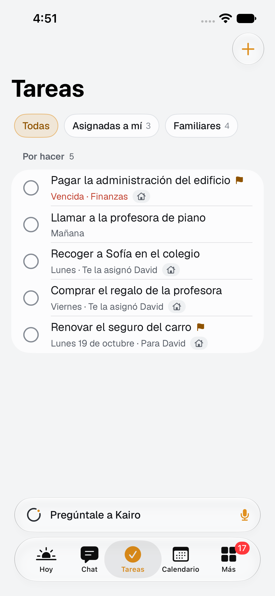 | 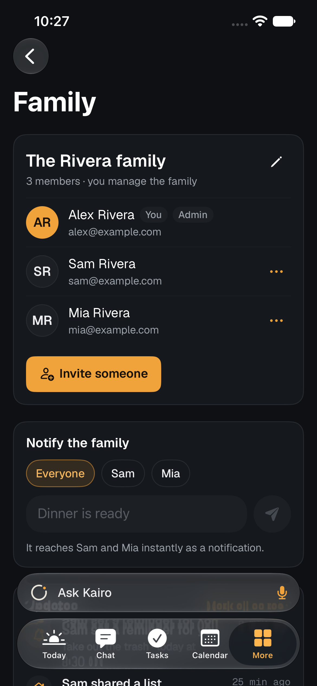 |

More screenshots in [`docs/screenshots/`](docs/screenshots). All screenshots use a made-up sample family.

## Status

| Part | State |
|---|---|
| Backend, dashboard | Complete and tested (automated tests plus end-to-end checks). |
| Android and Wear OS | Complete. Built and unit-tested in CI and exercised in screenshot tests; real-device testing is under way. |
| iPhone, iPad, Apple Watch | Feature-complete and compiling in CI (Xcode 27), tested in the simulator only. **Beta**: not yet verified on physical devices. |
| macOS app | Planned, not started. See the [roadmap](docs/ROADMAP.md). |

## Architecture

```
 Android (Kotlin)          iPhone, iPad, Watch (SwiftUI)     Wear OS        Browser
   "Hey Kairo" offline       widgets, Live Activities,        voice +        Dashboard (React)
   exact local alarms        Siri, AlarmKit, share            cards               │
          │  HTTPS + WebSocket          │                       │                │
          └─────────────────────────────┴───────────┬───────────┴────────────────┘
                                 ▼
                     Caddy (your subdomain, HTTPS)
                                 ▼
          ┌──────────── kairo container (Kotlin + Ktor) ──────────────┐
          │  REST API · SSE (streaming) · WebSocket · web dashboard   │
          │  Agent · family · schedulers · Google sync · push         │
          └──────┬────────────────────────┬─────────────────────┬─────┘
                 ▼                        ▼                     ▼
   PostgreSQL 18 + pgvector     Nan (api.nan.builders)    ntfy (optional)
   notes, tasks, embeddings     chat, voice, vision,      encrypted push to
                                embeddings                phones, no Firebase
```

| Folder | Contents |
|---|---|
| `backend/` | Kotlin 2.4 + Ktor 3.6, PostgreSQL + pgvector, Flyway. Agent with 30+ tools. |
| `dashboard/` | Vite + React + TypeScript + Tailwind v4. Built into the image and served by the backend. |
| `android/app` | Native app: Compose, Material 3 Expressive, adaptive for foldables and tablets. |
| `android/wear` | Wear OS app (standalone, pairs with a 6-digit code). |
| `android/core` | API client and models shared by phone and watch. |
| `ios/` | iPhone, iPad (and iPhone Duo) and Apple Watch app in SwiftUI (iOS 27) with widgets, Live Activities, controls, Siri and sharing. `KairoKit` Swift package. |
| `design/` | Design system (`DESIGN.md`), SVG icon and Geist fonts. |
| `docs/` | Deployment, API, Android, iOS, family, push without Firebase, Google Calendar, roadmap and screenshots. |

### AI models

Kairo talks to [Nan](https://api.nan.builders) through its OpenAI-compatible API. Defaults, all changeable in
*Settings > Assistant*:

| Use | Model | Why |
|---|---|---|
| Agent (chat and actions) | `deepseek-v4-flash` | The fastest and most accurate at chaining tool calls (5 chained actions in ~10 s). |
| Fallback | `qwen3.8-flash` | If the main model fails or is slow, Kairo retries with this one. |
| Vision (photos, invoices, screenshots) | `gemma4` | Reads text from images accurately. |
| Speech to text | `whisper` | Multilingual transcription; follows your language setting. |
| Text to speech | `kokoro` | Voices per language, chosen in *Settings > Assistant*. |
| Semantic search | `qwen3-embedding` (1024 dims) + `rerank` | Finds notes and memories by meaning. |
| Images | `flux-2-klein` / `qwen-image-2.1` | When you ask it to generate an image. |

You need a Nan API key. Other OpenAI-compatible providers are not tested.

## Quick start

Requirements: a Linux server with Docker and Docker Compose, a domain pointing to it, and Caddy (or any reverse
proxy) for HTTPS. Full step-by-step guide with a device test checklist: [`docs/DEPLOYMENT.md`](docs/DEPLOYMENT.md).

```bash
git clone https://github.com/david2701/Agent.git kairo && cd kairo
./scripts/generate-env.sh          # creates .env with random secrets and shows the initial password
nano .env                          # set NAN_API_KEY, KAIRO_OWNER_EMAIL, KAIRO_PUBLIC_URL, KAIRO_TIMEZONE
docker compose up -d --build
docker compose logs -f kairo       # wait for the "listening" line
```

Then add the block from [`deploy/Caddyfile.example`](deploy/Caddyfile.example) to your Caddyfile and run `caddy reload`:

```
kairo.yourdomain.com {
    reverse_proxy 127.0.0.1:8080
}
```

Open `https://kairo.yourdomain.com`, sign in with your email and the initial password, and change it in
*Settings > Security*. The default language is English (`KAIRO_DEFAULT_LANGUAGE=es` in `.env` switches the owner
account to Spanish; every person can change theirs in *Settings*).

- The container only listens on `127.0.0.1:8080`; public access goes through your proxy. Change the port with `KAIRO_HOST_PORT`.
- Optional push for phones: `docker compose --profile push up -d` starts ntfy; see [`docs/PUSH.md`](docs/PUSH.md).
- Family: sign in as admin and use *Family > Invite someone*; see [`docs/FAMILY.md`](docs/FAMILY.md).
- **Automatic backups**: the `backup` service saves a full copy to `./backups` every day (at `BACKUP_TIME`, 03:30 by
  default) and deletes copies older than `BACKUP_KEEP_DAYS` (14). Copy that folder off the server now and then, and keep
  your `.env` somewhere safe (without it the stored tokens cannot be decrypted). Manual backup:
  `docker compose exec backup /backup.sh now`. Restore: `./scripts/restore-backup.sh backups/kairo-YYYYMMDD-HHMM.dump`.
  You can also export everything as JSON from *Settings > Data*.
- Update: `git pull && docker compose up -d --build`. Database migrations run automatically.
- If Maven Central answers `429 Too Many Requests` while building, use a mirror:
  `MAVEN_MIRROR=https://maven-central.storage-download.googleapis.com/maven2/ docker compose build`.
- CI publishes the image to `ghcr.io/<your-user>/kairo` on every push to `main`, in case you prefer not to build on the server.

### Google Calendar (optional)

Follow [`docs/GOOGLE_CALENDAR.md`](docs/GOOGLE_CALENDAR.md): create an OAuth client in Google Cloud, put
`GOOGLE_CLIENT_ID` and `GOOGLE_CLIENT_SECRET` in `.env` and connect from *Settings > Google Calendar*. Changes sync
both ways every few minutes.

## Install the apps

### Android and Wear OS

Details in [`docs/ANDROID.md`](docs/ANDROID.md).

1. Download `app-release.apk` (phone) and `wear-release.apk` (watch) from *Actions > CI > kairo-apk*, or build them with
   `cd android && KAIRO_SERVER_URL=https://kairo.yourdomain.com ./gradlew assembleRelease`. Sign them with your own
   keystore (see the docs).
2. Install, open Kairo and enter your server URL, email and password.
3. In *Settings* turn on **Hey Kairo**, **unrestricted battery** and **exact alarms**. Optional: pick Kairo as the
   system digital assistant.
4. Watch: on the phone, *Settings > Pair watch* shows a 6-digit code to type on the watch.

### iPhone, iPad and Apple Watch

Details in [`docs/IOS.md`](docs/IOS.md).

1. On a Mac with **Xcode 27**, set your Team ID and identifiers in `ios/Config/Signing.xcconfig`.
2. Open `ios/Kairo.xcodeproj`, pick your iPhone and press ▶ (there are no external dependencies to install).
3. Open Kairo and enter your server URL, email and password, or *I have an invite code*.
4. Watch: it installs with the iPhone app and pairs by itself when the iPhone is nearby.

## Notifications without Firebase

Kairo has its own notification system and does not use Firebase or any Google service:

1. **Your own push with UnifiedPush**: your server sends each notice, end-to-end encrypted, to an ntfy instance that is
   also yours (`docker compose --profile push up -d`), and the ntfy app on the phone hands it to Kairo, even with the
   app closed.
2. **Direct connection** to your server (WebSocket) while the app is open, "Hey Kairo" is active or *Direct connection*
   is on: instant notices, and everything updates live across dashboard, phones and watch.
3. **Exact local alarms and a sync every 15 min**: reminders, event alerts and the morning briefing ring even with no
   internet.

Place-based reminders use Android's proximity alerts, without Google Play Services. On iPhone, reminders and events are
scheduled on the phone itself, and for family notices with the app closed you can enable Apple push (APNs) on your
server; it is optional. How to set it up: [`docs/PUSH.md`](docs/PUSH.md).

## Security and privacy

See [`SECURITY.md`](SECURITY.md) for the threat model and how to report a vulnerability.

- **Your data is yours**: everything lives on your server and in your database. Only the text and audio needed to answer go to Nan.
- **"Hey Kairo" works offline**: the phrase is detected inside the phone with Vosk; audio does not leave the device until you say it.
- **Prompt-injection protection**: text from other people, links or MCP servers reaches the AI as data, not as instructions.
  If after reading it the AI wants to delete, share or notify someone, Kairo asks you for a "yes" first.
- **Network protection (SSRF)**: Kairo does not fetch links, MCP servers or push endpoints on your internal network.
- Passwords with bcrypt, short-lived access tokens and rotating refresh tokens per device (sign out any device from
  *Settings > Devices*), login and pairing brute-force limits, per-person AI rate limits.
- Google tokens and MCP server headers encrypted with AES-256-GCM; attachments are served with expiring signed links.
- Unprivileged container, security headers, port bound to localhost only.
- On the phone, tokens are stored encrypted with the Android Keystore; on iPhone, in the keychain.
- Destructive actions by voice are logged and can be undone.
- Within a family, personal items stay private; invite codes are single-use and expire; when someone is removed their
  sessions stop working instantly.
- Push is encrypted for each phone (RFC 8291) and signed (VAPID): the ntfy server cannot read it.

## Local development

```bash
# Database
docker compose up -d db
# Backend (http://localhost:8080)
cd backend && set -a && . ../.env && set +a && KAIRO_DB_URL=jdbc:postgresql://localhost:5432/kairo ./gradlew run
# Dashboard with live reload (http://localhost:5173, proxies /api to the backend)
cd dashboard && npm install && npm run dev
# Tests
cd backend && ./gradlew test
cd android && ./gradlew :app:testDebugUnitTest
cd ios/KairoKit && swift test
```

To expose the database locally add `ports: ["127.0.0.1:5432:5432"]` to the `db` service. The full API contract is in
[`docs/API.md`](docs/API.md).

## Roadmap

Next up is a **native macOS app** (menu bar, global hotkey, Spotlight and App Intents, sharing `KairoKit` with iOS).
It is planned but **not started and not part of this release**. Other ideas: more languages, TestFlight and F-Droid
distribution, an SDK for custom agent tools, optional local models. See [`docs/ROADMAP.md`](docs/ROADMAP.md).

## Contributing

Contributions are welcome, especially translations and real-device testing. Read [`CONTRIBUTING.md`](CONTRIBUTING.md)
(build and test commands per part, how to add a language, code style).

## Design

The interface follows the [Taste](https://www.tasteskill.dev/) skill, installed in `.claude/skills/` with
`npx skills add Leonxlnx/taste-skill` (details in [`.claude/skills/README.md`](.claude/skills/README.md)): a single amber
accent `#F0A23B` over neutral grays, Geist typography, no gradients or emoji, complete states (loading, empty, error)
and animations that respect "reduce motion". Tokens in [`design/DESIGN.md`](design/DESIGN.md). On Android it translates
to Material 3 Expressive and on iOS to SwiftUI with Liquid Glass.

## License

Kairo is released under the [Apache License 2.0](LICENSE), which includes an express patent grant from every
contributor. Geist fonts are under the SIL OFL 1.1 (`design/fonts/OFL-LICENSE.txt`), the Taste skill under MIT, and the
Vosk speech model (downloaded on the phone) under Apache 2.0. See [`NOTICE`](NOTICE).
