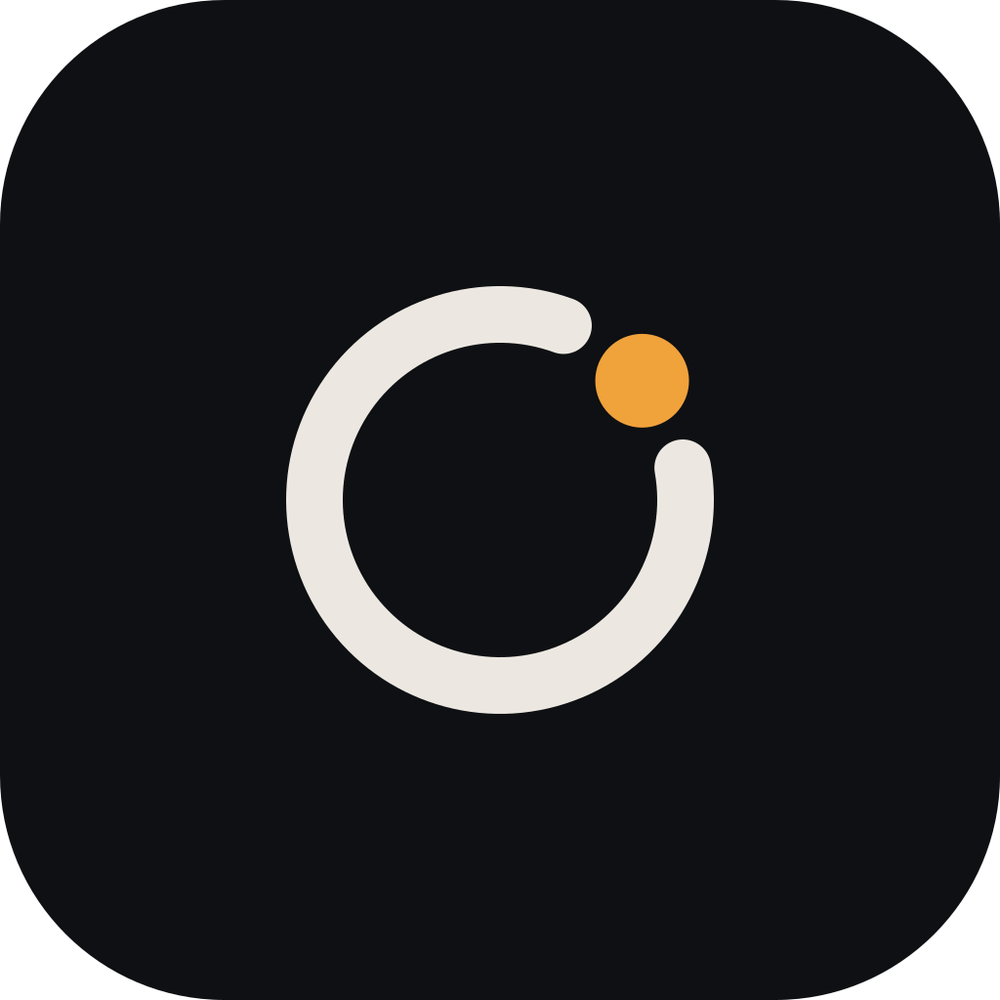
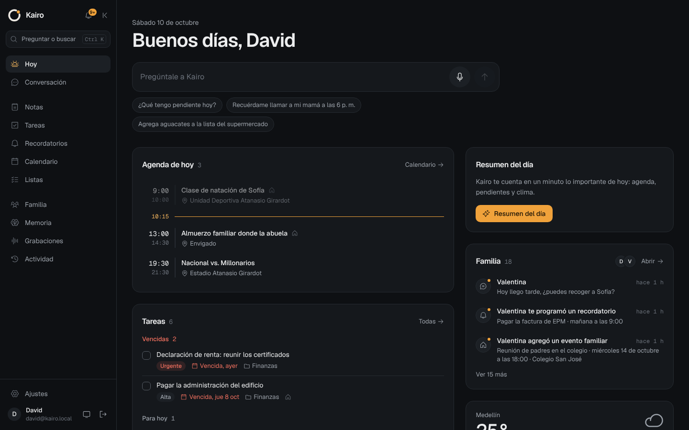
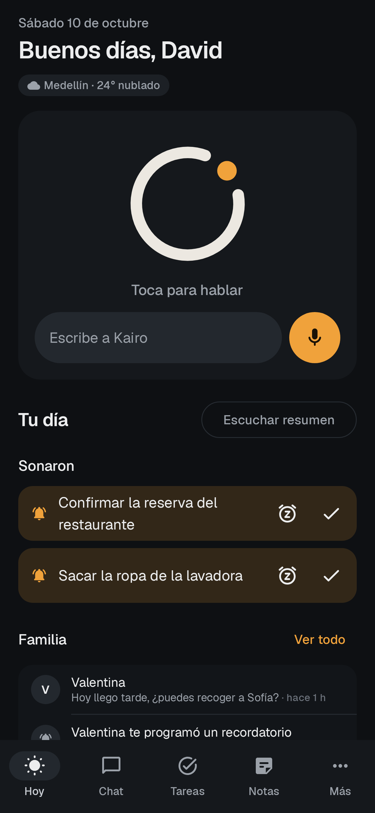
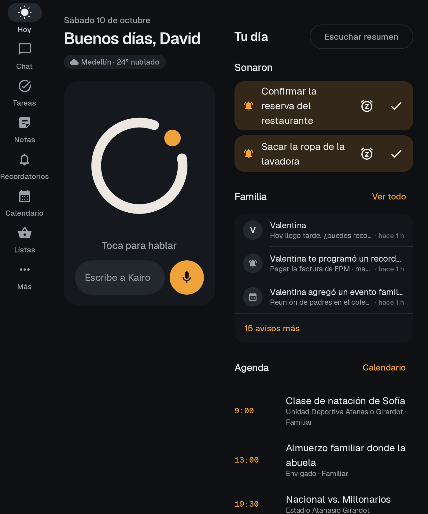
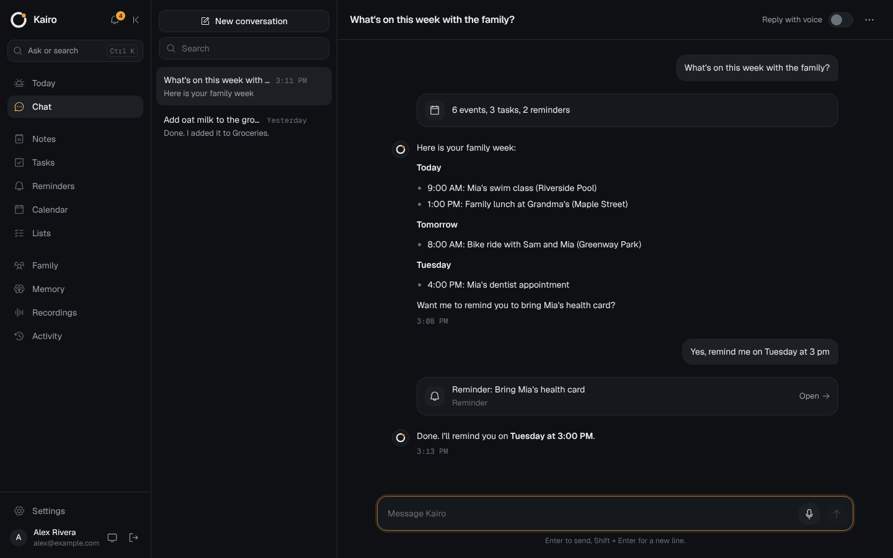
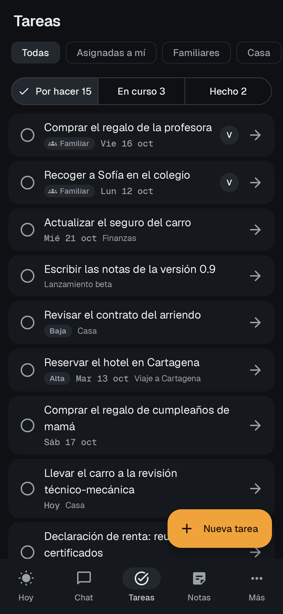
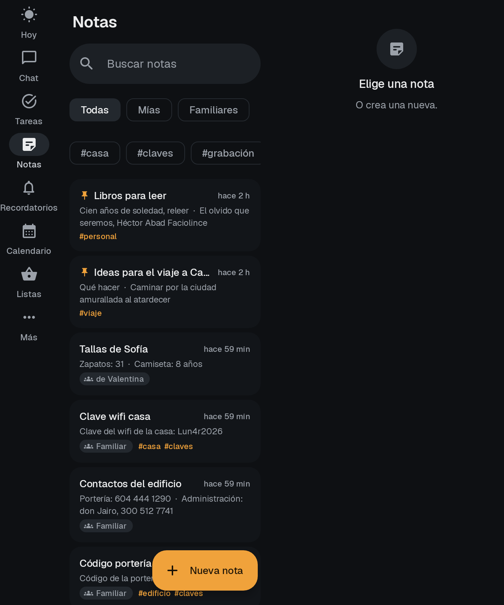
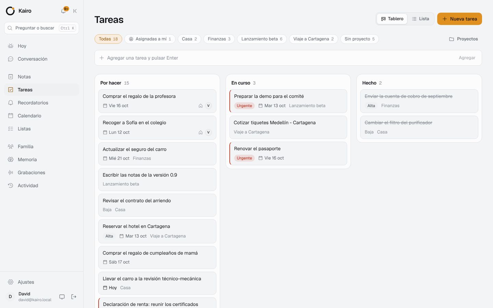
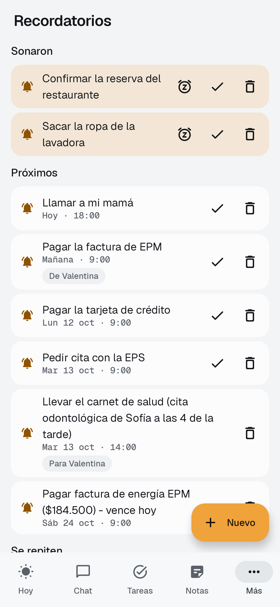
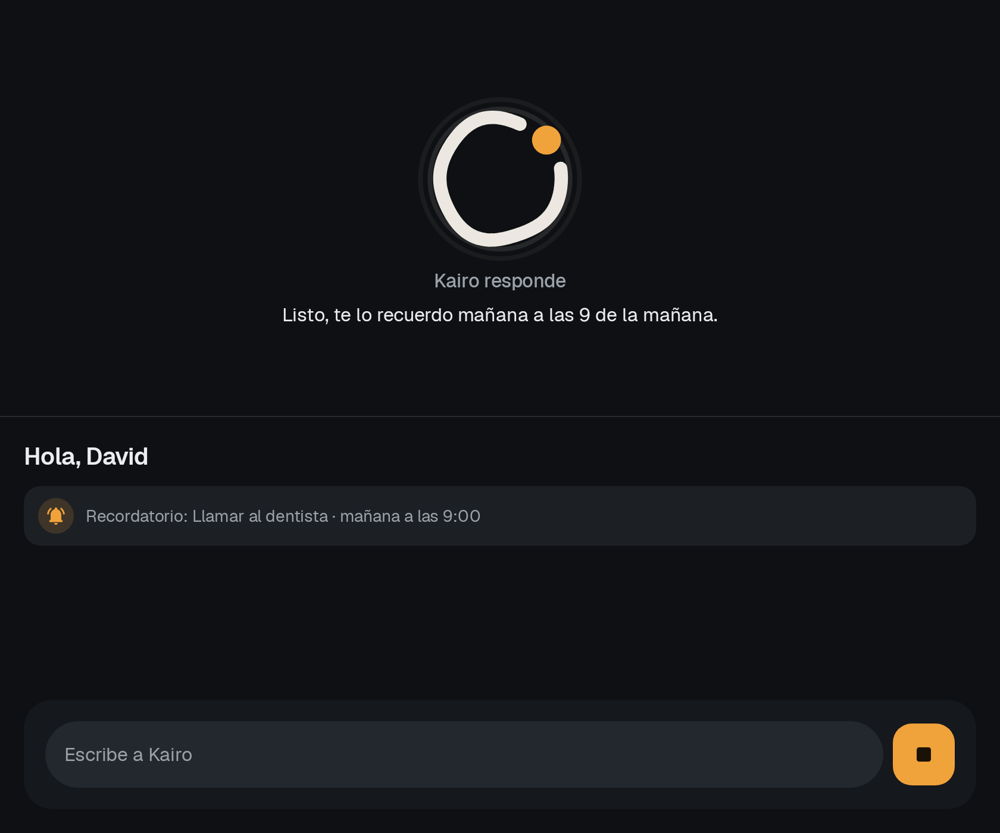

<p align="center">
  
</p>

<h1 align="center">Kairo</h1>

<p align="center">Tu asistente personal por voz, siempre atento. Funciona con los modelos de <b>Nan</b> y vive en tu propio servidor.</p>

---

*Kairós* es el momento oportuno: Kairo te avisa justo cuando lo necesitas. El ícono es un anillo
abierto (el ciclo del tiempo) con un punto ámbar (el instante preciso), que también funciona como orbe
de voz animado dentro de la app.

## Qué hace

Le hablas ("Oye Kairo...") o le escribes, y actúa:

| Área | Ejemplos |
|---|---|
| **Notas** | "Anota que la clave del wifi de la oficina es..." · búsqueda semántica ("¿qué anoté sobre el seguro?") · notas desde fotos |
| **Recordatorios** | por hora, recurrentes ("todos los lunes a las 8"), por lugar ("cuando llegue a casa"), posponer |
| **Tareas** | proyectos, prioridades, fechas, tablero Kanban, subtareas por voz |
| **Calendario** | crear, mover y consultar eventos; avisos previos; sincronización bidireccional con Google Calendar |
| **Listas** | compras y checklists por voz ("agrega leche y huevos a la lista del súper") |
| **Memoria** | recuerda tus preferencias y datos ("mi hija se llama...") y los usa en las respuestas |
| **Resumen del día** | cada mañana, con agenda, tareas, recordatorios y clima, leído en voz alta |
| **Grabaciones** | graba reuniones o notas de voz largas: transcripción, resumen, puntos clave y tareas |
| **Temporizadores y alarmas** | "pon un temporizador de 10 minutos" (en el teléfono) |
| **Compartir con Kairo** | textos, enlaces o fotos desde cualquier app (una factura se convierte en nota + recordatorio) |
| **Herramientas externas (MCP)** | conecta servidores MCP y Kairo usa sus herramientas |
| **Deshacer** | todo lo que hace Kairo queda en *Actividad* y se puede deshacer |
| **Familia** | cada persona con su cuenta en el mismo servidor; lo familiar lo ven todos: "agenda una cita compartida", "nuestra lista del súper", "recuérdale a Valentina...", "avísale a todos que..." |

Lo personal es privado (incluso para quien administra) y lo familiar se comparte con todos en casa.
Detalles en [`docs/FAMILIA.md`](docs/FAMILIA.md).

## Arquitectura

```
 Teléfonos de la familia (Kotlin)        Reloj (Wear OS)        Navegador
   "Oye Kairo" offline (Vosk)              voz + tarjetas        Dashboard (React)
   alarmas locales exactas                     │                    │
          │  HTTPS + WebSocket                 │                    │
          └──────────────────────┬─────────────┴────────────────────┘
                                 ▼
                     Caddy (tu subdominio, HTTPS)
                                 ▼
          ┌──────────── contenedor kairo (Kotlin + Ktor) ─────────────┐
          │  API REST · SSE (streaming) · WebSocket · Dashboard web   │
          │  Agente · familia · planificadores · Google sync · push   │
          └──────┬────────────────────────┬─────────────────────┬─────┘
                 ▼                        ▼                     ▼
   PostgreSQL 18 + pgvector     Nan (api.nan.builders)    ntfy (opcional)
   notas, tareas, embeddings    chat, voz, visión,        push cifrado a los
                                embeddings                teléfonos, sin Firebase
```

| Carpeta | Contenido |
|---|---|
| `backend/` | Kotlin 2.4 + Ktor 3.6, PostgreSQL + pgvector, Flyway. Agente con más de 30 herramientas. |
| `dashboard/` | Vite + React + TypeScript + Tailwind v4. Se compila dentro de la imagen y lo sirve el backend. |
| `android/app` | App nativa: Compose, Material 3 Expressive, adaptable a plegables y tablets. |
| `android/wear` | App de Wear OS (independiente, se vincula con un código de 6 dígitos). |
| `android/core` | Cliente de la API y modelos compartidos entre teléfono y reloj. |
| `design/` | Sistema de diseño (`DESIGN.md`), ícono en SVG y fuentes Geist. |
| `docs/` | API, Android, familia, push sin Firebase, Google Calendar y capturas. |
| `.claude/skills/` | Skill de diseño Taste usada para la UI. |

### Modelos de Nan elegidos

Revisé y probé todos los modelos disponibles en tu cuenta:

| Uso | Modelo | Por qué |
|---|---|---|
| Agente (chat y acciones) | `deepseek-v4-flash` | El más rápido y preciso llamando herramientas (5 acciones encadenadas en ~10 s). |
| Respaldo | `qwen3.8-flash` | Si el principal falla o tarda, Kairo reintenta con este. |
| Visión (fotos, facturas, capturas) | `gemma4` | Lee texto de imágenes con buena precisión. |
| Voz a texto | `whisper` | Transcripción en español. |
| Texto a voz | `kokoro` | Voces en español: `ef_dora` (por defecto), `em_alex`, `em_santa`. |
| Búsqueda semántica | `qwen3-embedding` (1024 dims) + `rerank` | Encuentra notas y memorias por significado. |
| Imágenes | `flux-2-klein` / `qwen-image-2.1` | Cuando le pides generar una imagen. |

Todos se pueden cambiar en *Ajustes > Asistente* del dashboard. `minimax-h3` respondió 401 (sin acceso con tu clave).

## Desplegar en tu servidor

Requisitos: Docker con Compose y Caddy (que ya tienes).

```bash
git clone <este repo> kairo && cd kairo
./scripts/generate-env.sh          # crea .env con secretos aleatorios y te muestra la contraseña inicial
nano .env                          # completa NAN_API_KEY, KAIRO_OWNER_EMAIL, KAIRO_PUBLIC_URL, KAIRO_TIMEZONE
docker compose up -d --build
docker compose logs -f kairo       # espera "Kairo escuchando en :8080"
```

Luego agrega a tu Caddyfile el bloque de [`deploy/Caddyfile.example`](deploy/Caddyfile.example) y ejecuta `caddy reload`:

```
kairo.tudominio.com {
    reverse_proxy 127.0.0.1:8080
}
```

Abre `https://kairo.tudominio.com`, entra con tu correo y la contraseña inicial y cámbiala en *Ajustes > Seguridad*.

- El contenedor sólo escucha en `127.0.0.1:8080`; el acceso público pasa por Caddy. Cambia el puerto con `KAIRO_HOST_PORT`.
- Push para los teléfonos (opcional): `docker compose --profile push up -d` levanta ntfy; ver [`docs/PUSH.md`](docs/PUSH.md).
- Familia: entra al dashboard como administrador y usa *Familia > Invitar a alguien*; ver [`docs/FAMILIA.md`](docs/FAMILIA.md).
- Datos persistentes en el volumen `kairo-db`. Copia de seguridad: `docker compose exec db pg_dump -U kairo kairo > kairo.sql`, o *Ajustes > Datos* en el dashboard (JSON con todo).
- Actualizar: `git pull && docker compose up -d --build`. Las migraciones de la base de datos se aplican solas.
- Si al compilar Maven Central responde `429 Too Many Requests`, usa un espejo:
  `MAVEN_MIRROR=https://maven-central.storage-download.googleapis.com/maven2/ docker compose build`.
- La CI publica la imagen en `ghcr.io/<tu-usuario>/kairo` en cada push a `main`, por si prefieres no compilar en el servidor.

### Google Calendar (opcional)

Sigue [`docs/GOOGLE_CALENDAR.md`](docs/GOOGLE_CALENDAR.md): creas un cliente OAuth en Google Cloud, pones
`GOOGLE_CLIENT_ID` y `GOOGLE_CLIENT_SECRET` en `.env` y conectas desde *Ajustes > Google Calendar*. Los
cambios viajan en ambos sentidos cada pocos minutos.

## Instalar la app

Detalles completos en [`docs/ANDROID.md`](docs/ANDROID.md).

1. Descarga `app-release.apk` (teléfono) y `wear-release.apk` (reloj) de *Actions > CI > kairo-apk*, o compílalos con `cd android && ./gradlew assembleRelease`.
2. Instala, abre Kairo y escribe la URL de tu servidor, tu correo y tu contraseña.
3. En *Ajustes* activa **Oye Kairo**, **batería sin restricciones** y **alarmas exactas**. Opcional: elige Kairo como asistente digital del sistema.
4. Reloj: en el teléfono, *Ajustes > Vincular reloj* muestra un código de 6 dígitos que escribes en el reloj.

## Avisos sin Firebase

Sí, Kairo tiene su propio sistema de avisos y no usa Firebase ni servicios de Google:

1. **Push propio con UnifiedPush**: tu servidor envía cada aviso cifrado de punta a punta a un ntfy que también es
   tuyo (`docker compose --profile push up -d`), y la app ntfy del teléfono se lo entrega a Kairo, con la app cerrada.
2. **Conexión directa** con tu servidor (WebSocket) mientras la app está abierta, "Oye Kairo" está activo o activas
   *Conexión directa*: avisos al instante y todo se actualiza en vivo entre dashboard, teléfonos y reloj.
3. **Alarmas locales exactas y sincronización cada 15 min**: recordatorios, avisos de eventos y el resumen matinal
   suenan aunque no haya internet.

Los recordatorios por lugar usan las alertas de proximidad de Android, sin Google Play Services.
Cómo configurarlo, en [`docs/PUSH.md`](docs/PUSH.md).

## Seguridad y privacidad

- **Tus datos son tuyos**: todo vive en tu servidor y tu base de datos. Sólo el texto y el audio necesarios para responder se envían a Nan.
- **"Oye Kairo" es offline**: la frase se detecta dentro del teléfono con Vosk; el audio no sale del dispositivo hasta que la dices.
- Contraseñas con bcrypt, sesiones con tokens de acceso cortos y tokens de renovación rotativos por dispositivo (puedes cerrar sesión en cualquier dispositivo desde *Ajustes > Dispositivos*).
- Tokens de Google y cabeceras de servidores MCP cifrados con AES-256-GCM; los adjuntos se sirven con enlaces firmados que caducan.
- Límite de intentos en el inicio de sesión, contenedor sin privilegios de root, cabeceras de seguridad, puerto sólo en localhost.
- En el teléfono, los tokens se guardan cifrados con Android Keystore.
- Acciones destructivas por voz quedan registradas y se pueden deshacer.
- En familia, lo personal de cada uno es privado; los códigos de invitación son de un solo uso y vencen; al quitar a
  alguien sus sesiones dejan de valer al instante.
- El push va cifrado para cada teléfono (RFC 8291) y firmado (VAPID): el servidor ntfy no puede leerlo.

## Desarrollo local

```bash
# Base de datos
docker compose up -d db
# Backend (http://localhost:8080)
cd backend && set -a && . ../.env && set +a && KAIRO_DB_URL=jdbc:postgresql://localhost:5432/kairo ./gradlew run
# Dashboard con recarga en vivo (http://localhost:5173, redirige /api al backend)
cd dashboard && npm install && npm run dev
# Pruebas
cd backend && ./gradlew test
cd android && ./gradlew :app:testDebugUnitTest
```

Para exponer la base de datos en local añade `ports: ["127.0.0.1:5432:5432"]` al servicio `db`.
El contrato completo de la API está en [`docs/API.md`](docs/API.md).

## Diseño

La interfaz sigue la skill [Taste](https://www.tasteskill.dev/), instalada en `.claude/skills/` con
`npx skills add Leonxlnx/taste-skill` (detalles en [`.claude/skills/README.md`](.claude/skills/README.md)): un solo
acento ámbar `#F0A23B` sobre grises neutros, tipografía Geist, sin degradados ni emojis, estados
completos (cargando, vacío, error) y animaciones que respetan "reducir movimiento". Tokens en
[`design/DESIGN.md`](design/DESIGN.md). En Android se traduce a Material 3 Expressive.

| Dashboard | Teléfono | Fold abierto |
|---|---|---|
|  |  |  |
|  |  |  |
|  |  |  |

Más capturas en [`docs/screenshots/`](docs/screenshots).

## Licencias

Fuentes Geist bajo SIL OFL 1.1 (`design/fonts/OFL-LICENSE.txt`). Skill Taste bajo MIT. Modelo de voz Vosk
(se descarga en el teléfono) bajo Apache 2.0.
