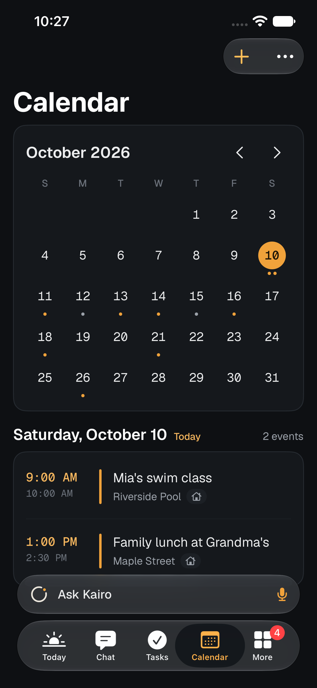
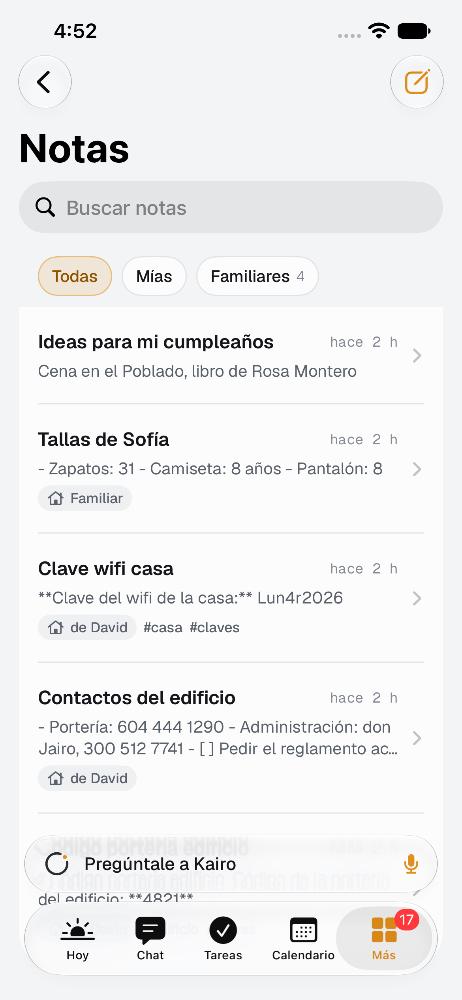
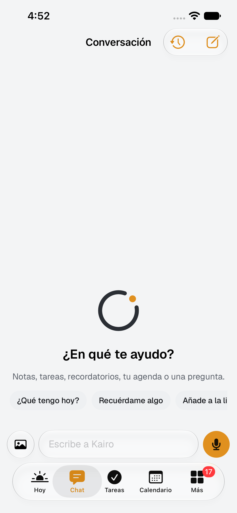
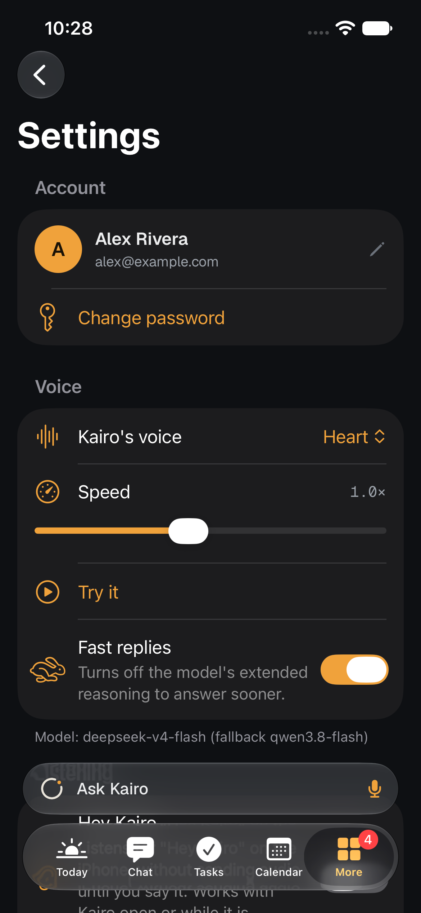

# Kairo for iPhone, iPad and Apple Watch

A native SwiftUI app (Swift 6, iOS 27 and watchOS 27) that connects to your Kairo server, just like the Android app.
All the code is in [`ios/`](../ios), and the Xcode project is already generated.

Other languages: [Spanish version](es/IOS.md). The app follows your device language: Spanish if it is set to Spanish,
English otherwise.

## What is included

- **Today**: greeting, weather, the orb to talk to Kairo, what rang, the family card, agenda, to-dos (tap to
  complete), today's reminders, lists and recent notes.
- **Voice**: a full-screen conversation with the animated orb, a transcript, cards for what Kairo did, and a spoken
  answer (Whisper and Kokoro on Nan, through your server). If Kairo asks you a question, it keeps listening.
  **"Hey Kairo"** (or **"Oye Kairo"** in Spanish) is recognized on the iPhone itself, using on-device speech
  recognition. The audio does not leave the phone until you say the phrase.
- **Chat** with history, streaming replies and images (the camera or the photo library go to `/capture`).
- **Tasks** (a list by status on iPhone, a drag-and-drop board on iPad), **Calendar** (month and hourly agenda),
  **Reminders** (by time, repeating or by place, also for another member), **Lists**, **Notes** (search by meaning,
  and markdown), **Memory**, meeting **Recordings**, **Activity** with Undo, **Family** and **Settings**.
- **Family**: shared items show a little house icon and the name of whoever created them. Invitations and access
  codes, family notices and updates. Join with a code or with the link `…/join?code=XXXX-XXXX` (the older
  `…/unirse?codigo=XXXX-XXXX` links still work).
- **Widgets**: Today (small, medium, large, extra large and Lock Screen), Next event with a countdown, an
  interactive List (check items without opening the app) and Talk to Kairo.
- **Live Activities** in the Dynamic Island and on the Lock Screen: the voice conversation, a meeting recording, the
  next event (when it is less than 45 minutes away), and the **timers and alarms** you ask for ("set a timer for 10
  minutes"). They are created with AlarmKit, so they ring like the Clock app's, even when the iPhone is silent, and
  you can pause or stop them from the Dynamic Island.
- **Control Center and Lock Screen**: "Talk to Kairo" and "My day" controls.
- **Siri and Shortcuts**: "Hey Siri, talk to Kairo", "Hey Siri, ask Kairo" (answers without opening the app) and
  "Open Kairo on Tasks". They also work for the **Action button**.
- **Save to Kairo** from any app's share sheet: text, links and images. Kairo decides whether it is a note, a task,
  an event or a list item, and shows you what it did.
- **Apple Watch**: talk to Kairo from your wrist (it records until you stop talking and reads the answer), Today,
  lists to check off, and complications (talk, next event and to-dos). It pairs on its own when the iPhone is
  nearby, or with the code from Settings > Apple Watch (this works for watches with cellular).
- **Notifications**: reminders, event alerts and the morning briefing are scheduled on the iPhone and ring even with
  no internet. Family notices arrive instantly while the app is open (WebSocket), on background refresh, and
  through Apple push if you set it up on the server (see below).
- **Location reminders** with `CLMonitor` (up to 20 places at a time), even when the app is closed.

| Today | Tasks | Calendar | Notes |
|---|---|---|---|
|  |  |  |  |
|  |  |  |  |

Screenshots taken in the iOS 27 simulator (iPhone 17 Pro) with test data (`ios/ci`).

## iPhone, iPad and iPhone Duo

The layout is chosen by *size class*, not by device model, as Apple recommends:

| Screen | Layout |
|---|---|
| iPhone, the outer screen of the iPhone Duo, iPad in Slide Over | Tabs (Today, Chat, Tasks, Calendar, More) with Liquid Glass and the "Ask Kairo" bar on top |
| iPad, the inner screen of the iPhone Duo, a large iPhone in landscape | A sidebar with every section and the "Talk to Kairo" button (⌘K) |

On wide screens, Today, Calendar, Notes, Lists and Chat show two columns, and Tasks shows a board. The app supports
all orientations and multiple windows on iPad. It does not use `UIScreen.main`, so it adapts by itself when you open
or close the iPhone Duo. With a keyboard, ⌘K opens voice and ⌘N creates an item.

## Build on your Mac

You need **Xcode 27** (it includes the iOS 27 and watchOS 27 SDKs).

1. Open `ios/Config/Signing.xcconfig` and set:
   - `DEVELOPMENT_TEAM`: your Team ID (Xcode > Settings > Accounts, or developer.apple.com > Membership).
   - `KAIRO_BUNDLE_ID`: an identifier of your own, for example `com.yourname.kairo`. The widgets, the share
     extension and the watch app hang off it (`.widgets`, `.share`, `.watchkitapp`).
   - `KAIRO_APP_GROUP` and `KAIRO_WATCH_APP_GROUP`: `group.` plus your identifier.
   - `KAIRO_KEYCHAIN_GROUP`: your identifier plus `.shared`.
   - `KAIRO_DEFAULT_SERVER` (optional): your server's address, so it is prefilled on the sign-in screen.
2. Open `ios/Kairo.xcodeproj`. Xcode downloads and builds the local `KairoKit` package (there are no external
   dependencies).
3. Choose the **Kairo** scheme and your iPhone, and press ▶. The first time, on the iPhone: Settings > General >
   VPN & Device Management > trust your account, and turn on Developer Mode.
4. The watch app installs together with the iPhone app (Watch app > Kairo > Install), or by choosing the
   **KairoWatch** scheme with the watch connected.

With automatic signing, Xcode creates the identifiers, the App Group and the profiles. Push, App Groups (widgets
with your data), Live Activities and the watch need the **Apple Developer Program**. With a free account, you can
try the app on your iPhone for 7 days if you remove the capabilities that Xcode marks as unavailable under
*Signing & Capabilities* (for example, Push Notifications).

If you change `ios/project.yml` (new files, targets, settings), regenerate the project:

```bash
brew install xcodegen
cd ios && xcodegen
```

### Layout

| Folder | Contents |
|---|---|
| `ios/KairoKit` | Swift package (SPM). `KairoCore`: models, the API client with SSE and WebSocket, date formatting, voice logic and the widget summary (Foundation only; its tests also run on Linux). `KairoUI`: colors, Geist, the orb and components. |
| `ios/App` | The app: global state, voice, "Hey Kairo", recordings, notifications, geofences, AlarmKit, Siri shortcuts and all the screens. |
| `ios/Widgets` | Widgets, controls and Live Activities. |
| `ios/Share` | The "Save to Kairo" extension. |
| `ios/Watch`, `ios/WatchWidgets` | The Apple Watch app and complications. |
| `ios/Shared` | Code shared by the app and its extensions (configuration, intents, Live Activity types). |
| `ios/ci` | A test server and automatic screenshots in the simulator. |

## Apple push (optional)

Kairo works without push. Reminders and events are scheduled on the iPhone, and family notices arrive while the app
is open or during background refresh. To receive them instantly with the app closed, set up APNs on your server
(see [PUSH.md](PUSH.md)) with a `.p8` key from your developer account. Xcode builds use the *sandbox*
environment. TestFlight and App Store builds use *production*. The app registers its token with
`POST /api/push/apns/register`, and in Settings > Notifications you can see whether the server has it enabled.

## Privacy and security

- The session is stored in the iPhone's keychain. The widgets and the share extension have **their own session** (in
  a shared keychain group), so token renewals never collide with the app. When you sign out, all of them are signed
  out.
- Permissions are requested only when you use them: microphone when you talk, speech recognition for "Hey Kairo",
  location to save places, and alarms when you set your first timer.
- The watch has its own session, which you can sign out from Settings > Devices.

## Tests and CI

- `cd ios/KairoKit && swift test`: tests for models (with real, anonymized server responses), dates, voice, SSE and
  notices. They run on macOS and on Linux.
- The [`ios.yml`](../.github/workflows/ios.yml) workflow builds the app, the widgets, the extension and the watch
  app with Xcode 27 on every change (about 3 minutes).
- [`ios-capturas.yml`](../.github/workflows/ios-capturas.yml) (named *iOS screenshots* in GitHub) is triggered by
  hand (*Actions > iOS screenshots > Run workflow*) or when `ios/ci/screenshots.sh` changes. It takes screenshots in
  the iPhone simulator (and the iPad one if you check the box) against a test server (`ios/ci/mock_server.py`, a
  made-up "Rivera family") and leaves them in the *ios-screenshots* artifact. Pick the language with the workflow
  input (English by default).

## Known limitations

- The app was built with Xcode 27 and tested in the iPhone simulator against a test server (the screenshots above),
  but not yet on a physical iPhone, iPad or Apple Watch, nor against your real server.
- "Hey Kairo" listens while Kairo is open or talking to you. iOS does not let an app listen all the time in the
  background the way Android does. That is what Siri, the Action button and the "Talk to Kairo" control are for.
- The iPhone Duo's reserved screen regions (`ReservedRegion`, iOS 27.1) are not used yet. The layout adapts to
  window size and safe areas instead.
